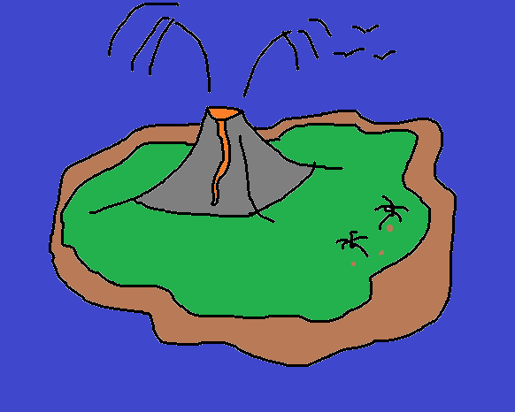
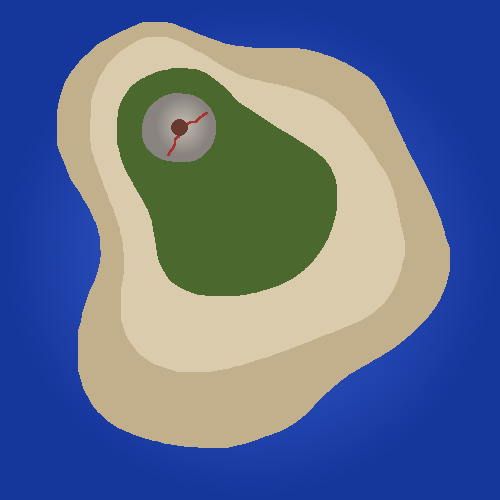
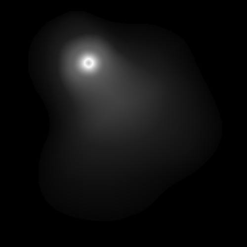
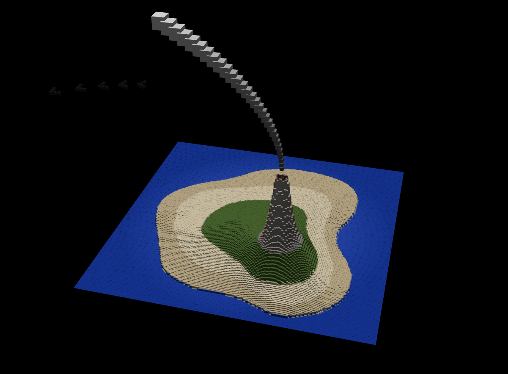
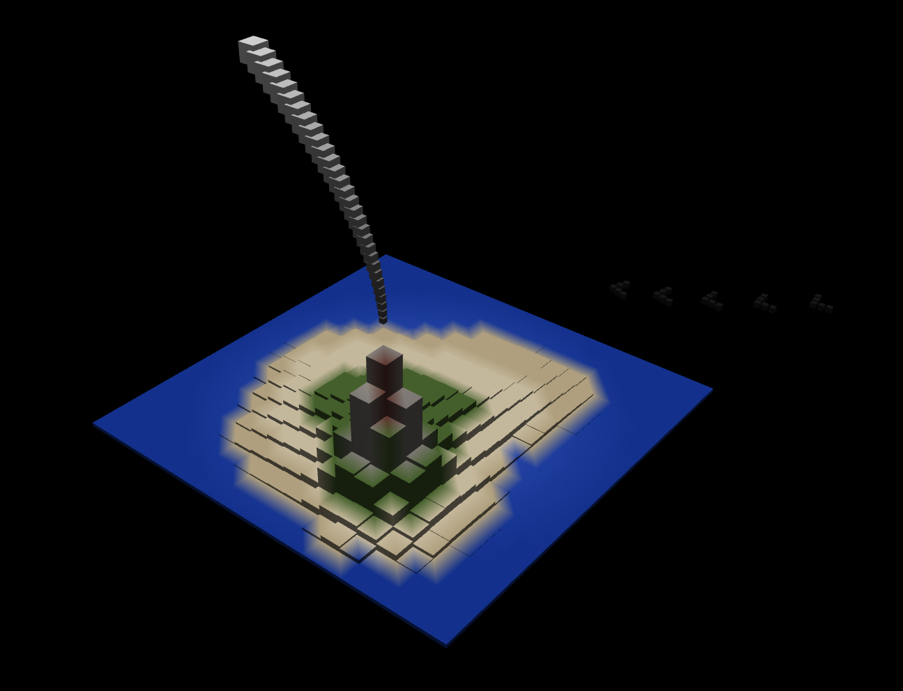
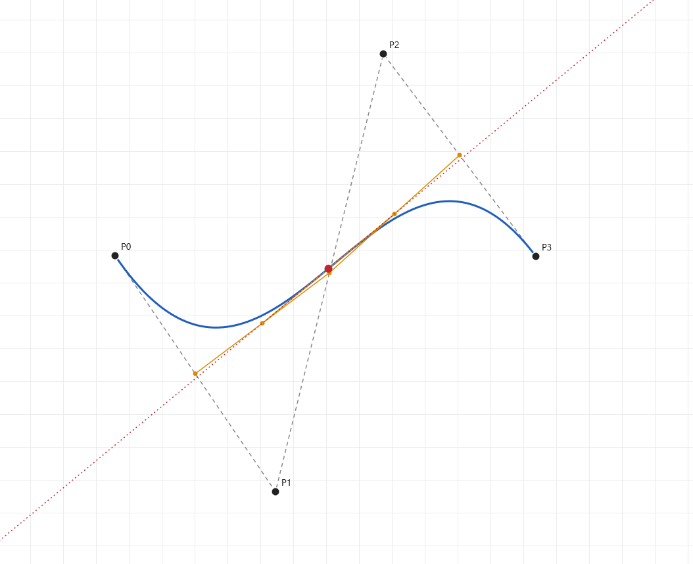
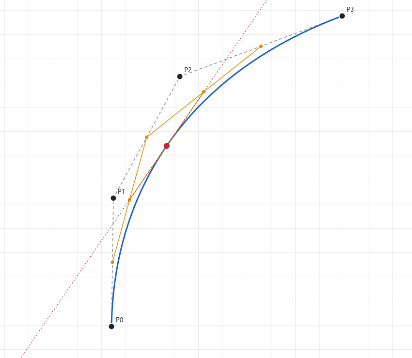

# Project 2: Cube World

**[Live Site](https://collinb.me/cs5160/project2)**

**[Demo Video](https://www.youtube.com/watch?v=TBrsX4mWlO0)**

## Instructions

### Controls

Use the slider at the top of the page to change the resolution of the world. There are no other controls and the scene rotates automatically.

## Design

My design for this project was to create a tropical island with a volcano. The volcano would have a plume of smoke or lava erupting out of it, and there would be birds and palm trees on the island.

I designed the initial island color map in an image editing software, which turned out like this:

The volcano was an easy shape to represent with a heightmap because it is essentially just a radial gradient with the center removed. After creating the color map, I created a heightmap layer on top of it with this idea in mind:

## Implementation

### Starting Point

I started with the webgl-cubes-v3 2.zip starter code which gave the boiler plate for a grid of cubes with random color and scaling. The first thing I changed was moving the cube color from the cube itself to its vertices passed into the fragment shader. At this point, the colors were still randomly generated. The colors are stored in an array of size `cubes.length * VERTEX_COUNT * 3`.

I also added a rotating camera, which uses the current frame time to determine the position. 

### Color Map and Height Map

Each vertex samples its color from where it lies on the color map, regardless of grid size. The face created by the vertices of the cube blend the colors so that there is a smooth gradient between different vertex colors (this can be seen around the water of the island).

The height map provides the height scaling for each cube. The brightness of the pixel being used is clamped to a minimum height and maximum height which is calculated based on the grid width. This is so that with larger grid sizes, the height doesn't flatten.

### Bezier Curves

To add the plume of smoke and the bird path, I used cubic Bezier curves:

$B(t) = (1-t)^3P_0 + 3(1-t)^2t\,P_1 + 3(1-t)t^2P_2 + t^3P_3$

The tangent of the Bezier curve is what determines the direction of travel for the birds:

$B'(t) = 3(1-t)^2(P_1-P_0) + 6(1-t)t\,(P_2-P_1) + 3t^2(P_3-P_2)$

The birds follow a horizontal S-shaped path across the sky with the following control points (in units of the grid width):

- P0 = (-0.8, 0.45, 0.3)
- P1 = (-0.2, 0.6, -0.6)
- P2 = ( 0.3, 0.35, 0.7)
- P3 = ( 0.8, 0.5, -0.2)

The smoke follows control points which are calculated at runtime so that it always starts right at the mouth of the volcano.

- P0 ~ Crater of the volcano, which is found by finding the average position of the brightest parts of the heightmap
- P1 ~ Straight up from P0
- P2 ~ Straight up from P1 plus a slight change in x
- P3 ~ Further from P2 diagonally and up

## Future Developments

I did not get the chance to add the palm trees that I had originally planned, and this would be my priority for future development. The original plan was to shape the palm trees' trunks using Bezier curves, and also to shape the leaves using Bezier curves. I also wanted to have coconuts (brown cubes) that would periodically fall from the trees

Another future development that I would add is a better sky texture. I wasn't able to figure out how to create a skybox before the deadline, and this is something that could've made the scene more immersive.